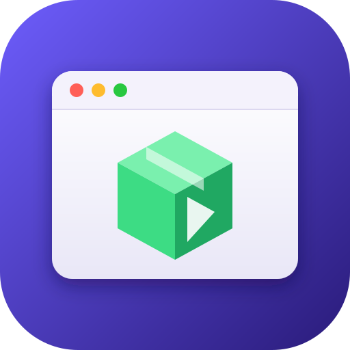

<p align="center">
  
</p>

<h1 align="center">Apk on Mac</h1>

<p align="center">
  <b>Run Android apps natively on Apple Silicon Macs.</b><br>
  No emulator, no virtual machine, no Linux underneath.
</p>

<p align="center">
  <a href="LICENSE"></a>
  
  
  
</p>

---

<p align="center">
  💬 Contact & support: <a href="https://t.me/baha_kabulov"><b>Telegram @baha_kabulov</b></a>
</p>

## What it is

Apk on Mac runs Android apps directly on Apple Silicon. Each app becomes an ordinary
macOS app: it has its own window and Dock icon, draws through the Mac's GPU, and
runs at native speed.

There is no emulator. Android is not booted in the background, and there is no
Linux kernel underneath. Instead, the Android application environment is
implemented directly on macOS:

| Part of an APK | How it runs |
|---|---|
| Java / Kotlin (DEX) | converted to JVM bytecode once, then run on a bundled OpenJDK |
| Android framework | reimplemented in Java to behave like AOSP |
| 64-bit ARM native code | loaded as is through an ELF loader and a Bionic → Darwin libc shim |
| 32-bit ARM native code | recompiled to arm64 ahead of time |
| OpenGL ES / Vulkan | ANGLE and MoltenVK, both on Metal |


## What's new in Apk on Mac

- **Drag and drop files:** drop files from Finder on an app window and the app receives them as a share (or open-with) when it handles one.
- **Lone modifier keys:** Shift, Ctrl, Option, Cmd and Caps Lock pressed alone reach games as Android key events (not in text fields).
- **Emoji and CJK text:** converted or composed text (emoji, IME candidates) is committed to the app as one string instead of per UTF-16 unit.
- **Russian UI:** the launcher follows your macOS language (English or Russian).
- **Homebrew:** `brew install --cask totktonado96/tap/apk-on-mac`.
- **Install from URL:** File > Install from URL… (⌘U), or drop a link on the window.
  Downloads with progress, checks it is an APK or split bundle, then installs it.
- **Compatibility warning:** x86-only apps are flagged before install, and 32-bit-only
  apps get a note in the install dialog.
- **Finder previews (Quick Look):** APK files show the app's own icon, and Space shows a
  card with name, version, SDK, ABIs, permissions and whether it runs on Apple Silicon.
- **Keyboard:** Russian and other non-Latin layouts work (WASD, Cmd+C/V by physical
  key), no stuck keys after Cmd+Tab, Home/End/Page Up/Down and F1–F12.
- **Notifications** in macOS Notification Center; clicking one opens the app.
- **Text-to-speech** with macOS voices.
- **Keep awake:** video apps keep the display on.
- **Audio** survives switching output devices (AirPods, headphones).
- **Window menu** (⌘M, Zoom) and per-app window position memory.
- **Reliability:** alarms and reminders, AsyncTask cancellation, per-app language,
  HMAC keys for 2FA apps, macOS system proxy, and many native-layer fixes.
- **Installer:** honest update dialog, no uninstall of a running app, a free-space
  check, and protection against name clashes with built-in macOS apps.

## Status

**Alpha. No builds are published yet.**

- [COMPATIBILITY.md](COMPATIBILITY.md) lists apps tested by hand.
- Found a bug or need help? Write in Telegram: [@baha_kabulov](https://t.me/baha_kabulov).

## Requirements

| | |
|---|---|
| **macOS** | 26.4 (Tahoe) or newer |
| **Hardware** | Any Apple Silicon Mac. Intel is not supported. |
| **Disk** | ~280 MB, plus roughly 1.5–3× each app's APK size |

## Install

With [Homebrew](https://brew.sh):

```
brew install --cask totktonado96/tap/apk-on-mac
```

Or download the DMG from the [Releases](https://github.com/totktonado96/apk-on-mac/releases)
page. The app is ad-hoc signed and not notarized: right-click it and choose Open the
first time, or run `xattr -dr com.apple.quarantine "/Applications/Apk on Mac.app"`.

## Building

See [BUILDING.md](BUILDING.md). You need the macOS 26.4 SDK (Xcode 26.4 or newer).

## Security

An Android app here runs as ordinary native code with **your macOS account's
permissions**. Unlike on a phone, there is no app sandbox around it. Only install
APKs you trust, from sources you trust.

## License

[GNU AGPL v3.0](LICENSE).

- Based on [Mac.apk](https://github.com/kksimp/Mac.apk), © Kaleb Simpson / Voltare and
  contributors. Not affiliated with or endorsed by that project.
- Changes in Apk on Mac are © their authors and are released under the same
  license.

Bundled third-party components (ANGLE, MoltenVK, Capstone, OpenJDK, Bouncy
Castle, AOSP resources, GLib/libintl under the LGPL, and others) keep their own
licenses. See [THIRD_PARTY_NOTICES.txt](THIRD_PARTY_NOTICES.txt).

## Contact

Questions, bug reports, partnerships: Telegram [@baha_kabulov](https://t.me/baha_kabulov).
